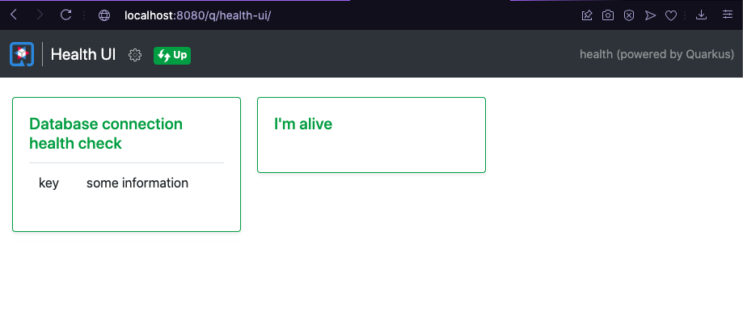

# Health 🩺

<center>
    <iframe src="https://pw2.rpmhub.dev/topicos/health/slides/index.html#/" title="Microprofile Health" width="90%" height="500" style="border:none;"></iframe>
</center>

As verificações de Health checks são usadas para verificar o estado de um serviço.
Esse tipo de recurso é propício para ambientes de infraestrutura em nuvem onde
processos automatizados mantêm o estado de nós de computação (kubernetes por
exemplo).

Nesse contexto, essas verificações são usadas para determinar se um nó de
computação precisa ser descartado/encerado e/ou eventualmente substituído por
outra instância. Assim, o Health checks não se destina (embora possa ser usado)
como uma solução de monitoramento de serviços para operadores humanos.
{: .fs-3 }

🩺 **Uma analogia simples**: pense no Health Check como o monitor de sinais
vitais de um paciente em um hospital. A cada poucos segundos, o monitor
verifica se o paciente está respirando (está "vivo" — *liveness*) e se ele
está em condições de receber um procedimento (está "pronto" — *readiness*).
Se o monitor detectar que o paciente parou de responder, a equipe médica (o
orquestrador, por exemplo o Kubernetes) age imediatamente: reanima ou
substitui o paciente por outro em condições de atendimento. O serviço nunca
precisa "se diagnosticar" sozinho para o mundo exterior, basta responder
honestamente quando perguntado "você está bem?".
{: .fs-3 }

Por padrão, o Quarkus utiliza a extensão [SmallRye Health](https://github.com/smallrye/smallrye-health/) como uma implementação da especificação [Microprofile Health](https://github.com/eclipse/microprofile-health).
{: .fs-3 }

## Exemplos no mundo real 🌍

* **Kubernetes**: os *probes* `livenessProbe` e `readinessProbe` de um Pod
apontam exatamente para os _endpoints_ `/q/health/live` e `/q/health/ready`
de um serviço Quarkus. Se o `livenessProbe` falhar algumas vezes seguidas, o
Kubernetes **reinicia** o container automaticamente. Se o `readinessProbe`
falhar, o Kubernetes **remove temporariamente** o Pod do balanceamento de
carga (sem reiniciá-lo), evitando enviar requisições para uma instância que
ainda está inicializando ou momentaneamente sobrecarregada.
{: .fs-3 }

* **Balanceadores de carga em nuvem** (por exemplo, AWS Elastic Load
Balancing ou um API Gateway): periodicamente, o balanceador faz uma
requisição HTTP ao _endpoint_ de *health check* de cada instância. Instâncias
que respondem com erro (ou não respondem) são automaticamente retiradas do
pool de servidores que recebem tráfego, até voltarem a responder "UP". Isso
evita que usuários sejam direcionados para uma instância travada ou fora do
ar.
{: .fs-3 }

## Configuração no Quarkus

Para se criar um projeto Quarkus com recursos de Health checks abra um terminal
de digite (linux, unix):

    mvn io.quarkus.platform:quarkus-maven-plugin:2.4.1.Final:create \
        -DprojectGroupId=dev.pw2 \
        -DprojectArtifactId=health \
        -Dextensions="smallrye-health"

    code health

Se você já tiver um projeto Quarkus e quiser instalar o `smallrye-health` digite
na raiz do projeto:

    ./mvnw quarkus:add-extension -Dextensions="smallrye-health"

Outra opção é adicionar no pom.xml a seguinte dependência:

```xml
<dependency>
    <groupId>io.quarkus</groupId>
    <artifactId>quarkus-smallrye-health</artifactId>
</dependency>
```

## Implementação

A extensão `smallrye-health` irá habilitar _endpoints_, são eles:

* `/q/health/live` - indica se o serviço está rodando (vivo).

* `/q/health/ready` - informa se o serviço está pronto para atender às solicitações (_requests_).

* `/q/health` - indica se o serviço está vivo e também pronto para atender às solicitações.

Os _endpoints_ retornam um objeto JSON contendo duas propriedades:

* status - o resultado geral de todos os procedimentos de verificação de saúde.

* checks - uma série de verificações individuais.

Um exemplo dos dados retornados no _endpoint_ `/q/health` :

```json
{
    "status": "UP",
    "checks": [
        {
            "name": "I'm alive",
            "status": "UP"
        },
        {
            "name": "Database connection health check",
            "status": "UP",
            "data": {
                "key": "some information"
            }
        }
    ]
}
```

Uma classe que implementa uma verificação de _health_ deve ser decorada com
`@ApplicationScoped` ou `@Singleton`. Estas anotações fazem com que seja criado
uma única instância de um _bean_ que irá responder a todas as requisições de
verificação de saúde. Se uma classe do bean não for decorada, então o escopo
`@Singleton` é usado automaticamente, no momento da utilização das anotações
`@Liveness` e `@Readiness`. Observe o exemplo abaixo:

```java
@Liveness
@Startup
public class Live implements HealthCheck {

    @Override
    public HealthCheckResponse call() {
        return HealthCheckResponse.up("Management is alive!");
    }

}
```

Como você pode ver, os procedimentos de verificação de integridade são definidos
por meio de _beans_ que implementam a interface `HealthCheck` e que são
decorados com uma das anotações de verificação de integridade, tais como:

* `@Liveness` - faz com o que o bean responda no _endpoint_  `/q/health /live` e
  indique que o serviço está vivo(rodando).
* `@Readiness` - faz com o que o bean responda no _endpoint_  `/q/health/ready`
  e indique que o serviço está pronto para receber requisições.
* `@Startup` - faz com que o bean seja instanciado no início da aplicação.

Assim, para atender ao endpoint `/q/health/ready` você pode implementar, por exemplo, a classe `Ready.java` conforme o trecho de código abaixo:

```java
@Readiness
public class Ready implements HealthCheck {

    @Inject
    @RestClient
    PingRC service;

     @Override
    public HealthCheckResponse call() {
        HealthCheckResponseBuilder response =
            HealthCheckResponse.named(Ready.class.getName());
        checkCatalogService(response);
        return response.build();
    }

    private HealthCheckResponseBuilder checkCatalogService(
            HealthCheckResponseBuilder response) {
        if (service.ping().equals("Pong")) {
            response.up().withData("CatalogService", "up");
        }
        return response;
    }
}
```

Lembre-se de que a classe `Ready` é um bean Singleton pois não foi anotada.
🚨 Uma observação interessante, `javax.ejb.Singleton` são transacionais, porém,
`javax.inject.Singleton` não são, ou seja, não suportam acessos concorrentes.

No exemplo acima, a classe `Ready` verifica se o serviço de catálogo está
disponível. Para isso, a classe `Ready` injeta um Rest Client chamado do
serviço de catálogo chamado `PingRC`. Assim, o método privado
`checkCatalogService` verifica se o serviço de catálogo está disponível e
retorna um objeto `HealthCheckResponseBuilder` com o status do serviço de
catálogo. Logo, o método `call` retorna um objeto `HealthCheckResponse` com o
status do serviço de catálogo.

A extensão `smallrye-health` também pode criar uma URL `/q/health-ui` para que
você observe as  verificações de saúde por meio de uma interface Web, conforme
ilustra a Figura 1. A URL `/q/health-ui` é habilita por padrão nos modos de
desenvolvimento e teste, porém, pode ser explicitamente configurada para o
modo de produção se a propriedade do Quarkus `quarkus.smallrye-health.ui.enable=true`
receber o valor `true`.

    http://localhost:8080/q/health-ui/

<center>
    <br/>
    Figura 1 - Health UI
</center>

## Código 💡

Um código de exemplo desse documento pode ser encontrado no Github:

```sh
git clone -b dev https://github.com/rodrigoprestesmachado/pw2
code pw2/exemplos/books

```

## Exercício de Fixação Prático 🏋️

Antes de partir para o exercício principal, resolva os cinco exercícios
simples abaixo. Eles são propositalmente pequenos e diretos, o objetivo é
ganhar confiança com a criação de verificações de *liveness* e *readiness*
antes de aplicá-las em uma arquitetura maior.
{: .fs-3 }

**1) Seu primeiro liveness check.** Crie uma classe decorada com `@Liveness`
que implementa `HealthCheck` e sempre retorna `HealthCheckResponse.up("alive")`
(veja a seção [Implementação](#implementação)). Acesse
`http://localhost:8080/q/health/live` e confira o JSON retornado.
{: .fs-3 }

**2) Simulando uma falha.** Crie uma classe decorada com `@Readiness` que
retorna propositalmente `response.down()` (sem consultar nada externo).
Acesse `http://localhost:8080/q/health/ready` e observe o valor da
propriedade `status` e o código de status HTTP retornado pela requisição.
{: .fs-3 }

**3) Adicionando informações extras.** Modifique o `@Readiness` do exercício
anterior (ou crie um novo) para retornar `up()` e usar o método `withData`
para incluir uma informação extra, por exemplo, a versão do serviço:
`response.up().withData("version", "1.0.0")`. Visualize o resultado no JSON
retornado pelo _endpoint_ `/q/health`.
{: .fs-3 }

**4) Observando pela interface Web.** Em modo de desenvolvimento, acesse
`http://localhost:8080/q/health-ui/` e identifique visualmente quais checks
estão `UP` e quais estão `DOWN`, com base nas classes criadas nos exercícios
anteriores (veja a Figura 1, mostrada mais acima).
{: .fs-3 }

**5) Dependendo de outro serviço.** Crie um `@Readiness` que, por meio de um
Rest Client (como no exemplo da classe `Ready` na seção
[Implementação](#implementação)), verifica se outro serviço está disponível.
Teste duas vezes: uma com o serviço dependente no ar (deve responder `UP`) e
outra com o serviço dependente desligado (deve responder `DOWN`).
{: .fs-3 }

💡 Se os cinco exercícios acima funcionaram, você já domina o essencial de
Health Checks no Quarkus: criar verificações de *liveness* e *readiness*,
adicionar dados extras e depender de outros serviços. O exercício abaixo
apenas aplica essas mesmas ideias em uma arquitetura com múltiplos serviços.
{: .fs-3 }

---

No projeto da rede [social de empréstimo de livros](https://github.com/rodrigoprestesmachado/pw2/tree/dev/exemplos/books), adicione um Health Check no serviço management para verificar
se o serviço de usuários se encontra disponível. Como resolver: Crie um método
no Web Service do serviço de usuários para verificar se o serviço está
disponível e, por meio de um Rest Cliente, faça com que o serviço de
management verifique se o serviço de usuários está disponível.
{: .fs-3 }

## Teste seus conhecimentos 🧠

<center>
    <iframe src="https://pw2.rpmhub.dev/topicos/health/questions.html"
        title="Microprofile Health" width="90%" height="500"
        style="border:none;background-color:white;">
    </iframe>
</center>

## Referências 📚

* Alex Soto Bueno; Jason Porter; [Quarkus Cookbook: Kubernetes-Optimized Java Solutions.](https://www.amazon.com.br/gp/product/B08D364VMD/ref=as_li_tl?ie=UTF8&camp=1789&creative=9325&creativeASIN=B08D364VMD&linkCode=as2&tag=rpmhub-20&linkId=2f82a4bb959a1797ec9791e0af68d1af) Editora: O'Reilly Media, 2020.

* SMALLRYE HEALTH disponível em: [https://quarkus.io/guides/smallrye-health](https://quarkus.io/guides/smallrye-health)

<center>
<a href="https://rpmhub.dev" target="blanck"></a><br/>
<a rel="license" href="http://creativecommons.org/licenses/by/4.0/">CC BY 4.0 DEED</a>
</center>