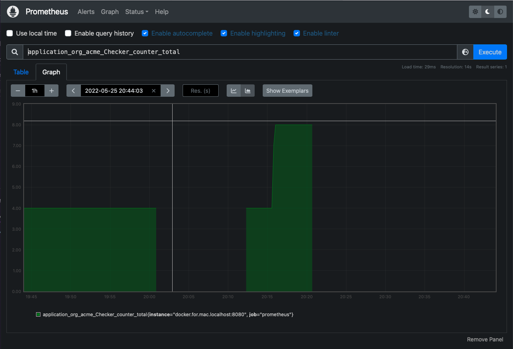

<!-- .slide: data-background-opacity="0.3" data-background-image="https://pw2.rpmhub.dev/topicos/metrics/slides/img/title.jpg" data-transition="convex" -->
# Metrics 📏
<!-- .element: style="margin-bottom:100px; font-size: 60px; color:white; font-family: Marker Felt;" -->

Pressione 'F' para tela cheia
<!-- .element: style="margin-bottom:10px; font-size: 15px; color:white" -->

[versão em pdf](?print-pdf)
<!-- .element: style="margin-bottom 25px; font-size: 15px; color:white" -->


<!-- .slide: data-background="#21093D" data-transition="convex" -->
## Por que métricas? 🤔
<!-- .element: style="margin-bottom:40px; font-size: 50px; color:white; font-family: Marker Felt;" -->

* Em produção não dá para abrir a IDE e colocar um breakpoint
<!-- .element: style="margin-bottom:35px; font-size: 26px; color:white" -->

* Quantas requisições por segundo cada endpoint recebe?
<!-- .element: style="margin-bottom:35px; font-size: 26px; color:white" -->

* O tempo de resposta subiu? Quantos HTTP 500 estão acontecendo?
<!-- .element: style="margin-bottom:35px; font-size: 26px; color:white" -->

* Quanta memória a aplicação usa? O banco está sobrecarregado?
<!-- .element: style="margin-bottom:35px; font-size: 26px; color:white" -->


<!-- .slide: data-background="#21093D" data-transition="convex" -->
## Micrometer 📏
<!-- .element: style="margin-bottom:50px; font-size: 50px; color:white; font-family: Marker Felt;" -->

* Biblioteca de métricas adotada pelo Quarkus
<!-- .element: style="margin-bottom:40px; font-size: 26px; color:white" -->

* Fachada: a aplicação mede uma vez e o Micrometer exporta para Prometheus, Datadog, InfluxDB e outros
<!-- .element: style="margin-bottom:40px; font-size: 26px; color:white" -->

* Quatro medidores: **Counter**, **Gauge**, **Timer** e **DistributionSummary**
<!-- .element: style="margin-bottom:40px; font-size: 26px; color:white" -->


<!-- .slide: data-background="#21093D" data-transition="convex" -->
## Kit de Medidores 🧰
<!-- .element: style="margin-bottom:40px; font-size: 50px; color:white; font-family: Marker Felt;" -->

* 🔢 **Counter** (*"Catraca/Odômetro"*): só sobe (pedidos, erros, logins)
<!-- .element: style="margin-bottom:22px; font-size: 24px; color:white" -->

* 🌡️ **Gauge** (*"Velocímetro"*): sobe e desce (fila, conexões, memória)
<!-- .element: style="margin-bottom:22px; font-size: 24px; color:white" -->

* ⏱️ **Timer** (*"Cronômetro"*): duração e frequência (HTTP, SQL, REST Client)
<!-- .element: style="margin-bottom:22px; font-size: 24px; color:white" -->

* ⚖️ **DistributionSummary** (*"Balança"*): valores que não são tempo (bytes, R$)
<!-- .element: style="margin-bottom:22px; font-size: 24px; color:white" -->

* ⚡ **`@Counted` / `@Timed`**: pacote `io.micrometer.core.annotation`, nome no atributo `value`
<!-- .element: style="margin-bottom:22px; font-size: 22px; color:#FFD580" -->


<!-- .slide: data-background="#21093D" data-transition="convex" -->
## Micrometer no Quarkus
<!-- .element: style="margin-bottom:40px; font-size: 50px; color:white; font-family: Marker Felt;" -->

```bash
./mvnw quarkus:add-extension -Dextensions='micrometer-registry-prometheus'
```
<!-- .element: style="margin-bottom:30px; font-size: 20px; font-family: arial; color:black; background-color: #F2FAF3;" -->

* Endpoint no formato **OpenMetrics/Prometheus**:
<!-- .element: style="margin-bottom:20px; font-size: 26px; color:white" -->

```text
http://localhost:8080/q/metrics
```
<!-- .element: style="margin-bottom:20px; font-size: 22px; font-family: arial; color:black; background-color: #F2FAF3;" -->


<!-- .slide: data-background="#21093D" data-transition="convex" -->
## Obtendo o MeterRegistry
<!-- .element: style="margin-bottom:25px; font-size: 46px; color:white; font-family: Marker Felt;" -->

* A extensão mantém **um único** registro, compartilhado por toda a aplicação
<!-- .element: style="margin-bottom:18px; font-size: 23px; color:white" -->

```java
// 1. Construtor — @Inject é opcional se for o único construtor
@Inject
public ItemResource(MeterRegistry registry) {
    this.registry = registry;
}
```
<!-- .element: style="margin-bottom:16px; font-size: 16px; font-family: arial; color:black; background-color: #F2FAF3;" -->

```java
// 2. Campo — @Inject é obrigatório
@Inject
MeterRegistry registry;

// 3. O mesmo bean, pelo registro global
MeterRegistry registry = Metrics.globalRegistry;
```
<!-- .element: style="margin-bottom:12px; font-size: 16px; font-family: arial; color:black; background-color: #F2FAF3;" -->


<!-- .slide: data-background="#21093D" data-transition="convex" -->
## Counter 🔢
<!-- .element: style="margin-bottom:25px; font-size: 50px; color:white; font-family: Marker Felt;" -->

```java
this.contadorAcessos = registry.counter(
    "itens.consultas.total", "tipo", "geral");
contadorAcessos.increment();
```
<!-- .element: style="margin-bottom:16px; font-size: 18px; font-family: arial; color:black; background-color: #F2FAF3;" -->

```text
itens_consultas_total{tipo="geral"} 1.0
```
<!-- .element: style="margin-bottom:16px; font-size: 18px; font-family: arial; color:black; background-color: #F2FAF3;" -->

* Ponto vira underscore. Se o nome ainda não termina em `total`, o Prometheus acrescenta `_total`
<!-- .element: style="margin-bottom:14px; font-size: 22px; color:white" -->

* `example.prime.number` → `example_prime_number_total`
<!-- .element: style="margin-bottom:14px; font-size: 22px; color:#b0e0ff" -->


<!-- .slide: data-background="#21093D" data-transition="convex" -->
## @Counted ⚡
<!-- .element: style="margin-bottom:30px; font-size: 50px; color:white; font-family: Marker Felt;" -->

```java
import io.micrometer.core.annotation.Counted;

@Counted(value = "itens.rapido.execucoes",
         description = "Total de chamadas ao endpoint rapido")
public String endpointRapido() {
    return "Executado!";
}
```
<!-- .element: style="margin-bottom:20px; font-size: 18px; font-family: arial; color:black; background-color: #F2FAF3;" -->

* No `/q/metrics`: `itens_rapido_execucoes_total`
<!-- .element: style="margin-bottom:20px; font-size: 24px; color:#b0e0ff" -->


<!-- .slide: data-background="#21093D" data-transition="convex" -->
## Timer ⏱️
<!-- .element: style="margin-bottom:25px; font-size: 50px; color:white; font-family: Marker Felt;" -->

```java
import io.micrometer.core.annotation.Timed;

@Timed(value = "itens.processar.duracao",
       description = "Tempo gasto no processamento de itens")
public String processarItem() { ... }
```
<!-- .element: style="margin-bottom:16px; font-size: 18px; font-family: arial; color:black; background-color: #F2FAF3;" -->

* `itens_processar_duracao_seconds_count` — execuções
<!-- .element: style="margin-bottom:12px; font-size: 22px; color:white" -->

* `itens_processar_duracao_seconds_sum` — segundos acumulados
<!-- .element: style="margin-bottom:12px; font-size: 22px; color:white" -->

* `itens_processar_duracao_seconds_max` — maior duração da janela
<!-- .element: style="margin-bottom:12px; font-size: 22px; color:white" -->

```java
registry.timer("operacao.demorada").record(() -> fazerCalculoPesado());
```
<!-- .element: style="margin-bottom:12px; font-size: 16px; font-family: arial; color:black; background-color: #F2FAF3;" -->


<!-- .slide: data-background="#21093D" data-transition="convex" -->
## Gauge 🌡️
<!-- .element: style="margin-bottom:25px; font-size: 50px; color:white; font-family: Marker Felt;" -->

```java
private final AtomicInteger itensEmEstoque = new AtomicInteger(10);

Gauge.builder("loja.estoque.atual", itensEmEstoque, AtomicInteger::get)
    .description("Quantidade atual de itens em estoque")
    .register(registry);
```
<!-- .element: style="margin-bottom:18px; font-size: 16px; font-family: arial; color:black; background-color: #F2FAF3;" -->

* O Gauge lê o valor no momento da coleta. O objeto observado precisa continuar referenciado
<!-- .element: style="margin-bottom:16px; font-size: 22px; color:white" -->

* Valor que só cresce (total de requisições) é Counter. O `rate()` do Prometheus espera contador
<!-- .element: style="margin-bottom:16px; font-size: 22px; color:#ffdd99" -->


<!-- .slide: data-background="#21093D" data-transition="convex" -->
## DistributionSummary ⚖️
<!-- .element: style="margin-bottom:25px; font-size: 46px; color:white; font-family: Marker Felt;" -->

```java
DistributionSummary resumo = DistributionSummary
    .builder("vendas.valor.pagamento")
    .baseUnit("BRL")
    .description("Valores dos pagamentos efetuados")
    .register(registry);

resumo.record(149.90);
```
<!-- .element: style="margin-bottom:16px; font-size: 16px; font-family: arial; color:black; background-color: #F2FAF3;" -->

* `vendas_valor_pagamento_BRL_count`
<!-- .element: style="margin-bottom:10px; font-size: 22px; color:white" -->

* `vendas_valor_pagamento_BRL_sum`
<!-- .element: style="margin-bottom:10px; font-size: 22px; color:white" -->

* `vendas_valor_pagamento_BRL_max`
<!-- .element: style="margin-bottom:10px; font-size: 22px; color:white" -->


<!-- .slide: data-background="#21093D" data-transition="convex" -->
## Tags dimensionais 🏷️
<!-- .element: style="margin-bottom:25px; font-size: 50px; color:white; font-family: Marker Felt;" -->

* Sem as pastas `base`, `vendor` e `application`. O recorte é feito com tags
<!-- .element: style="margin-bottom:18px; font-size: 23px; color:white" -->

```java
registry.counter("vendas.total", "forma_pagamento", "pix").increment();
registry.counter("vendas.total", "forma_pagamento", "cartao_credito").increment();
```
<!-- .element: style="margin-bottom:14px; font-size: 16px; font-family: arial; color:black; background-color: #F2FAF3;" -->

```text
vendas_total{forma_pagamento="pix"} 1.0
vendas_total{forma_pagamento="cartao_credito"} 1.0
```
<!-- .element: style="margin-bottom:14px; font-size: 16px; font-family: arial; color:black; background-color: #F2FAF3;" -->

* Cada combinação de tags é uma série. Tag com valor aberto (id, texto livre) multiplica as séries sem limite
<!-- .element: style="margin-bottom:12px; font-size: 20px; color:#ffdd99" -->


<!-- .slide: data-background="#21093D" data-transition="convex" -->
## Métricas automáticas 🤖
<!-- .element: style="margin-bottom:30px; font-size: 46px; color:white; font-family: Marker Felt;" -->

* **HTTP:** `http_server_requests_seconds_count/sum/max`
<!-- .element: style="margin-bottom:18px; font-size: 23px; color:white" -->

* Tags `uri`, `method`, `status` e `outcome`. O `uri` é o template (`/catalogo/pedido/{tipo}`)
<!-- .element: style="margin-bottom:18px; font-size: 22px; color:#b0e0ff" -->

* **JVM:** heap, threads, GC e CPU
<!-- .element: style="margin-bottom:18px; font-size: 23px; color:white" -->

* **Netty:** `allocator_memory_used` e `allocator_memory_pinned` (`memory_type=heap|direct`)
<!-- .element: style="margin-bottom:18px; font-size: 22px; color:white" -->

* Com a extensão no projeto: Agroal, Hibernate ORM, cache, Redis, gRPC, Kafka e RabbitMQ
<!-- .element: style="margin-bottom:18px; font-size: 22px; color:white" -->

* O medidor só aparece no `/q/metrics` depois que o código que o registra executou
<!-- .element: style="margin-bottom:16px; font-size: 22px; color:#ffdd99" -->


<!-- .slide: data-background="#21093D" data-transition="convex" -->
## Prometheus
<!-- .element: style="margin-bottom:40px; font-size: 50px; color:white; font-family: Marker Felt;" -->

O [Prometheus](https://prometheus.io) busca as métricas (pull): de tempos em tempos ele chama o `/q/metrics` e guarda séries temporais.
<!-- .element: style="margin-bottom:30px; font-size: 25px; color:white" -->

<br/>


<!-- .slide: data-background="#21093D" data-transition="convex" -->
## docker-compose.yml
<!-- .element: style="margin-bottom:30px; font-size: 50px; color:white; font-family: Marker Felt;" -->

```yml
services:
  prometheus:
    image: prom/prometheus:v3.11.3
    container_name: prometheus
    ports:
      - "9090:9090"
    volumes:
      - ./prometheus.yml:/etc/prometheus/prometheus.yml
    extra_hosts:
      - "host.docker.internal:host-gateway"
```
<!-- .element: style="margin-bottom:20px; font-size: 18px; font-family: arial; color:black; background-color: #F2FAF3;" -->

* `extra_hosts` faz o `host.docker.internal` funcionar no **Linux**. No Docker Desktop (macOS e Windows) o nome já resolve
<!-- .element: style="margin-bottom:16px; font-size: 22px; color:white" -->


<!-- .slide: data-background="#21093D" data-transition="convex" -->
## prometheus.yml
<!-- .element: style="margin-bottom:30px; font-size: 50px; color:white; font-family: Marker Felt;" -->

```yml
global:
  scrape_interval: 15s

scrape_configs:
  - job_name: "quarkus-app"
    metrics_path: "/q/metrics"
    static_configs:
      - targets: ["host.docker.internal:8080"]
```
<!-- .element: style="margin-bottom:20px; font-size: 20px; font-family: arial; color:black; background-color: #F2FAF3;" -->

```sh
docker compose up -d
```
<!-- .element: style="margin-bottom:16px; font-size: 20px; font-family: arial; color:black; background-color: #F2FAF3;" -->

* Painel em `http://localhost:9090`
<!-- .element: style="margin-bottom:16px; font-size: 24px; color:white" -->


<!-- .slide: data-background="#21093D" data-transition="convex" -->
## Exercícios de fixação 🎯
<!-- .element: style="margin-bottom:30px; font-size: 46px; color:white; font-family: Marker Felt;" -->

* 🟢 **Ex. 1:** contador `catalogo.buscas.total` → `catalogo_buscas_total`
<!-- .element: style="margin-bottom:16px; font-size: 22px; color:white" -->

* ⏱️ **Ex. 2:** `@Timed` em `/catalogo/relatorio` → `catalogo_relatorio_tempo_seconds_*`
<!-- .element: style="margin-bottom:16px; font-size: 22px; color:white" -->

* 🌡️ **Ex. 3:** Gauge `fila.tarefas.pendentes`
<!-- .element: style="margin-bottom:16px; font-size: 22px; color:white" -->

* 🏷️ **Ex. 4:** tag `tipo` em `pedidos.recebidos.total`
<!-- .element: style="margin-bottom:16px; font-size: 22px; color:white" -->

* 🤖 **Ex. 5:** `http_server_requests_seconds_count` com `uri` no template
<!-- .element: style="margin-bottom:16px; font-size: 22px; color:white" -->

* 🧠 Quiz na página
<!-- .element: style="margin-bottom:16px; font-size: 22px; color:#FFD580" -->

  [Exercícios na página](https://pw2.rpmhub.dev/topicos/metrics/metrics.html#colocando-tudo-em-prática-observabilidade-na-prática-)
<!-- .element: style="margin-bottom:12px; font-size: 20px; color:#FFD580" -->


<!-- .slide: data-background="#21093D" data-transition="convex" -->
## Referências 📚
<!-- .element: style="margin-bottom:40px; font-size: 50px; color:white; font-family: Marker Felt;" -->

* Alex Soto Bueno; Jason Porter; [Quarkus Cookbook: Kubernetes-Optimized Java Solutions.](https://www.amazon.com.br/gp/product/B08D364VMD/ref=as_li_tl?ie=UTF8&camp=1789&creative=9325&creativeASIN=B08D364VMD&linkCode=as2&tag=rpmhub-20&linkId=2f82a4bb959a1797ec9791e0af68d1af) Editora: O'Reilly Media, 2020.
<!-- .element: style="margin-bottom:28px; font-size: 22px; color:white" -->

* Micrometer no Quarkus: [https://quarkus.io/guides/telemetry-micrometer](https://quarkus.io/guides/telemetry-micrometer)
<!-- .element: style="margin-bottom:28px; font-size: 22px; color:white" -->

* Micrometer: [https://micrometer.io/docs](https://micrometer.io/docs)
<!-- .element: style="margin-bottom:28px; font-size: 22px; color:white" -->

* Prometheus: [https://prometheus.io/docs/introduction/overview/](https://prometheus.io/docs/introduction/overview/)
<!-- .element: style="margin-bottom:28px; font-size: 22px; color:white" -->

<center>
<a href="https://rpmhub.dev" target="blanck"></a><br/>
<a rel="license" href="http://creativecommons.org/licenses/by/4.0/">CC BY 4.0 DEED</a>
</center>
